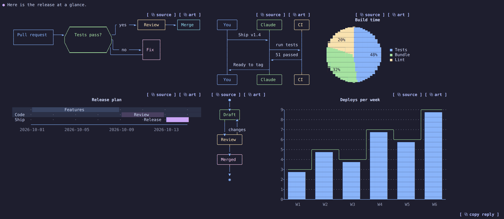
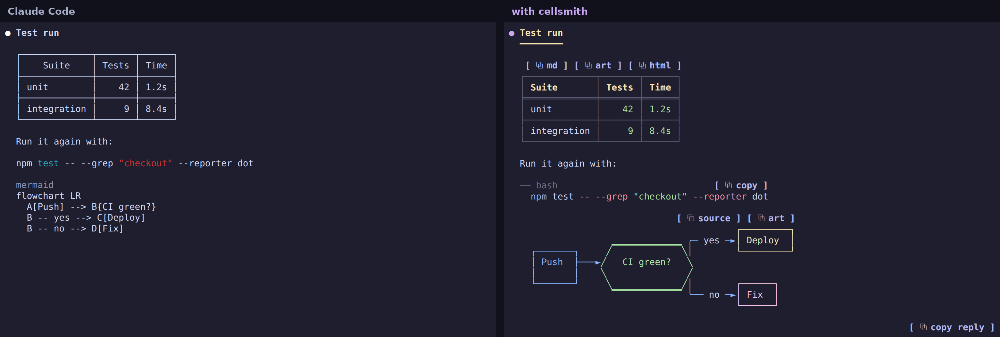

# cellsmith

Claude Code replies drawn on the terminal's cell grid. cellsmith is a Claude Code mod that gives tables, code, headings, lists and tool calls a color theme, and turns every `mermaid` block into a diagram: [Pele](https://pele.run) lays it out, and cellsmith's own engine, [pelext](https://github.com/4our4ace/pelext), draws the layout with box-drawing lines, block fills and real text. It needs nothing but text and true color, so it works in any modern terminal.

> [!NOTE]
> - **A fork of [prismantis](https://github.com/NahumLitvin/prismantis).** cellsmith started as prismantis 0.14.0 by Nahum Litvin and keeps its themes, tables, code, math, tool rows and copy buttons. The diagram engine is new.
> - **Agent-coded.** Everything cellsmith adds (code, tests and these docs) was written and reviewed entirely by AI coding agents.



## Install

Requires Claude Code **2.1.287** or later. In Claude Code:

```
/plugin marketplace add 4our4ace/cellsmith
/plugin install cellsmith@cellsmith
```

Then `/reload-plugins`, or start a new session. `/cellsmith` shows the help screen, `/cellsmith demo` a reply with everything it draws, and `/cellsmith theme <name>` switches among 16 themes. If you use [prismantis](https://github.com/NahumLitvin/prismantis), disable it (`claude plugin disable prismantis@prismantis`), since both draw replies.

Every option, screenshot and limit is in the [plugin README](plugin/README.md).



## What it draws

- **Diagrams:** flowcharts, sequence, state, class and ER diagrams, pie, bar and line charts, gantt charts, timelines, mindmaps, quadrant charts, git graphs and sankey diagrams. A diagram too wide for the terminal is laid out again narrower or top-down; one that still does not fit falls back to box art, then to its source.
- **Text:** themed tables with copy buttons, highlighted code, headings, task lists, quotes and alerts, numbers and paths in their own colors, Hebrew and Arabic right to left, and LaTeX math as images in kitty and Ghostty.
- **Claude Code itself:** one-line tool rows, your prompts in a bubble, bar or chevron, and the turn footer.

No network calls. It runs a program only when you click `⧉ html` (the clipboard helper) or turn on LaTeX (RaTeX's renderer).

## Repository

| Path | What |
| --- | --- |
| `.claude-plugin/marketplace.json` | the repository is a plugin marketplace named `cellsmith` |
| `plugin/` | the mod, the only part that gets installed; its own [README](plugin/README.md) and [AGENTS.md](plugin/AGENTS.md) |
| `scripts/` | dev only: the vendor build (Pele with 13 diagram types, and pelext), benchmark, render snapshots |
| `tools/` | `ansi2html.mjs`: a `tmux capture-pane -e` dump of a live session to HTML, for screenshots (see `plugin/.claude/skills/live-check`) |

## Draw diagrams without Claude Code

The diagram engine is its own package, [pelext](https://github.com/4our4ace/pelext), with its own tests and quality tools. It draws Mermaid files in any terminal:

```sh
npx github:4our4ace/pelext diagram.mmd --theme dracula
```

## Develop

```sh
git clone https://github.com/4our4ace/cellsmith
claude plugin marketplace add ./cellsmith    # a local marketplace is read live: /reload-plugins after an edit
claude plugin install cellsmith@cellsmith
npm --prefix cellsmith/scripts install
cd cellsmith/plugin
claude plugin validate .
claude plugin test .
../scripts/node_modules/.bin/tsc -p .
npm --prefix ../scripts run snapshot
npm --prefix ../scripts run bench:check
```

`npm --prefix scripts run build:vendor` rebuilds `plugin/hooks/vendor/` after changing Pele's version, pelext's tag or the bundled diagram types. Tested on Linux (WSL); macOS and native Windows are not checked by hand yet.

## Credits and license

MIT. cellsmith is © [4our4ace](https://github.com/4our4ace). It is a fork of [prismantis](https://github.com/NahumLitvin/prismantis) 0.14.0, © Nahum Litvin, and draws diagrams laid out by [Pele](https://github.com/obsidianmd/pele), © kepano, with [pelext](https://github.com/4our4ace/pelext). See [plugin/LICENSE](plugin/LICENSE) and [plugin/docs/THIRD_PARTY_NOTICES.md](plugin/docs/THIRD_PARTY_NOTICES.md).

cellsmith is an independent project. It is not affiliated with or endorsed by Anthropic, Obsidian, the prismantis project or the Mermaid project. Claude and Claude Code are trademarks of Anthropic.
