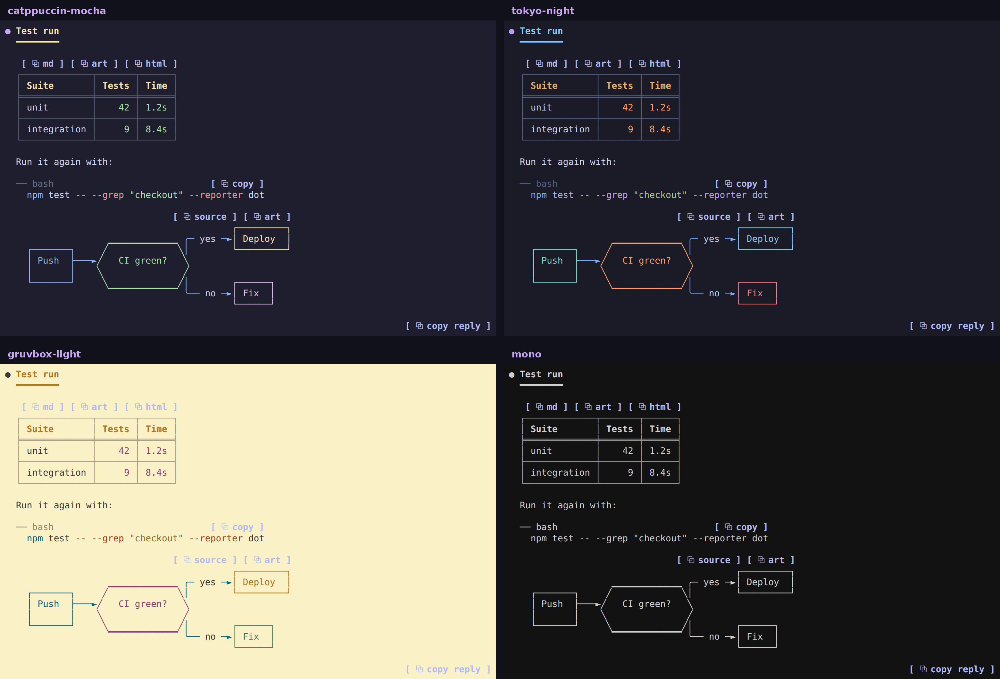
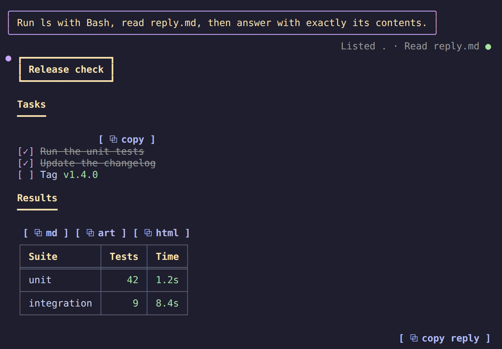
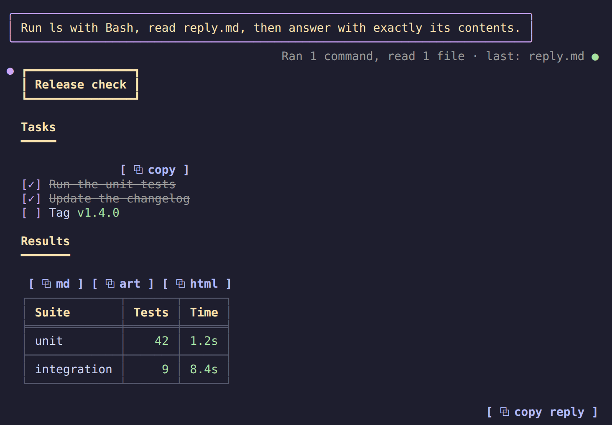
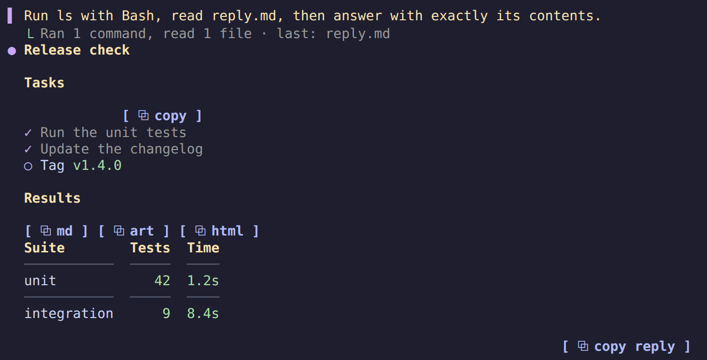
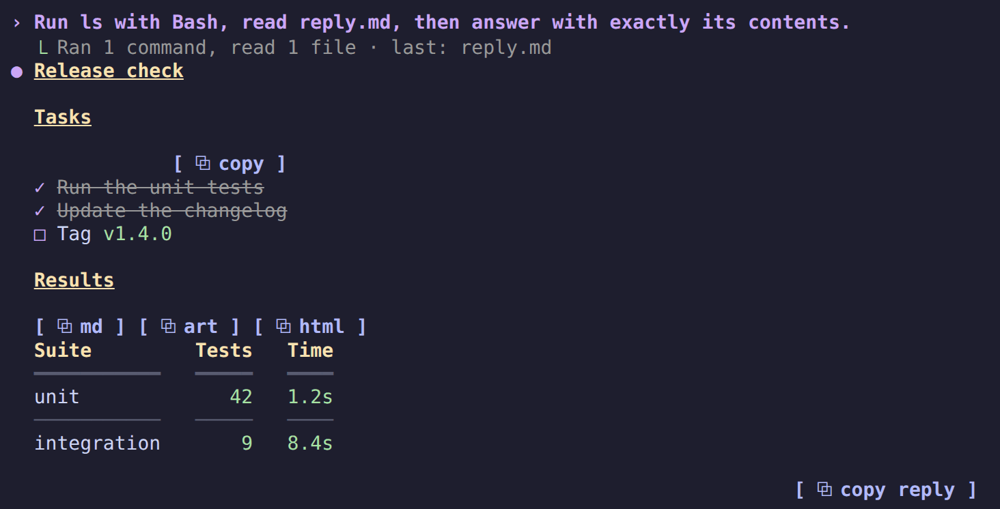
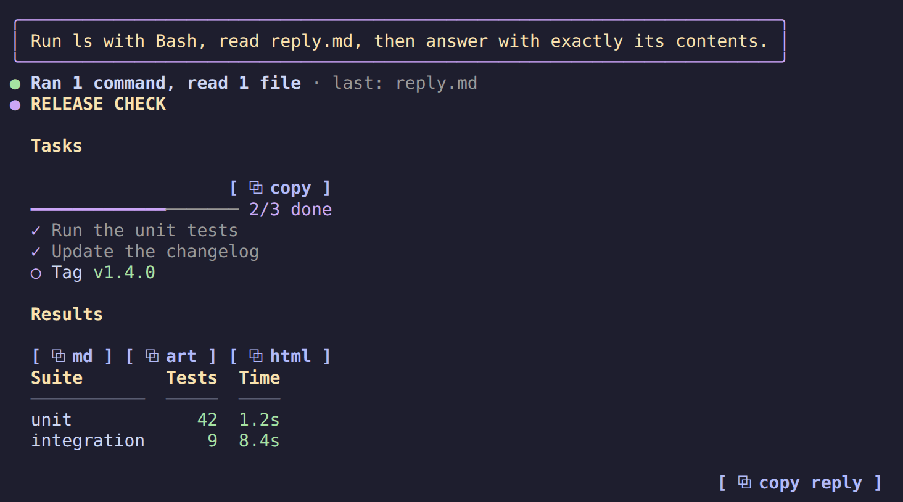

# cellsmith

> Claude Code replies drawn on the terminal's cell grid: themed tables and code, and Mermaid diagrams as real box-drawing art.

cellsmith is a Claude Code mod that redraws assistant replies. Tables, code, headings, lists, links and tool calls get a color theme, and every `mermaid` block becomes a diagram: [Pele](https://pele.run) lays it out, and cellsmith draws the layout with box-drawing lines, block fills and real text. It needs nothing but text and true color, so it works in any modern terminal: Windows Terminal, kitty, Ghostty, WezTerm, iTerm2, Rio, VS Code.


## TL;DR

- Claude Code prints mermaid as source and tool calls as walls of text. cellsmith draws them: flowcharts, sequence, state, class and ER diagrams, pie, bar and line charts, gantt charts, timelines, mindmaps, quadrant charts, git graphs and sankey diagrams, plus typeset LaTeX math in kitty and Ghostty, colored tables and code, and quiet tool rows.
- 15 palettes plus `mono`, and copy buttons on everything.
- Two commands to install, `/plugin` to turn it off. Claude Code's own renderer comes back the moment you do.
- No network calls. It runs a program only when you click `⧉ html` (the clipboard helper) or turn on LaTeX (RaTeX's renderer).


## Install

Requires Claude Code **2.1.287** or later. In Claude Code:

```
/plugin marketplace add 4our4ace/cellsmith
/plugin install cellsmith@cellsmith
```

or from a shell, `claude plugin marketplace add 4our4ace/cellsmith` and `claude plugin install cellsmith@cellsmith`. Run `/reload-plugins` (or start a new session) and the next reply draws with cellsmith.

If you use [prismantis](https://github.com/NahumLitvin/prismantis), turn it off, since both draw replies:

```bash
claude plugin disable prismantis@prismantis
```

To update, run this, then `/reload` in every open session. A session keeps the version it loaded until it reloads.

```bash
claude plugin marketplace update cellsmith && claude plugin update cellsmith@cellsmith
```

To uninstall:

```bash
claude plugin uninstall cellsmith@cellsmith
```

For LaTeX math, install RaTeX's renderer and set `latex` to `true`; see [LaTeX math](#latex-math). Until then formulas draw as text.

## Features

| Feature | What you get |
| --- | --- |
| [Themes](#themes) | `/cellsmith theme <name>` switches on the spot. 16 themes and 20 color slots you can override |
| [Tables](#tables) | colored headers, rules, column alignment, colored numbers, sized to the terminal |
| [Code](#code) | a language header and copy button, Prism highlighting in two dozen languages, shell lines colored like a prompt |
| [Diagrams and charts](#diagrams-and-charts) | flowcharts, sequence, state, class and ER diagrams, bar and line charts, one color per box, participant and bar |
| [LaTeX math](#latex-math) | `$$` and ` ```math ` formulas typeset as images in kitty and Ghostty by [RaTeX](https://github.com/erweixin/RaTeX), text everywhere else |
| [Layout](#layout) | back-to-back tables and diagrams sit side by side and wrap on narrow terminals |
| [Copy buttons](#copy-buttons) | `⧉ md`, `⧉ art` and `⧉ html` on tables, `[ ⧉ copy ]` on code, lists and quotes, `/cellsmith copy` without a mouse |
| [Tool rows](#tool-rows) | `Ran gh pr view 12`, `Read ~/src/app.ts`, groups summed up as `Ran 3 commands, read 2 files`, with status dots; `toolOutput: quiet` hides what Claude only read and says in plain words what each call did |
| [Turn footer](#turn-footer) | `✻ Baked for 6m 20s` with the duration in the number color |
| [Slash commands](#slash-commands) | command output (`/cost`, `/context`, plugin commands) gets the same tables and code styling |
| [Diagram hints](#diagram-hints) | a short model-only note on each prompt so Claude reaches for diagrams and charts when they help |
| [Text](#text) | bold, italic, strikethrough, inline code, links, versions, durations, percentages and paths in their own colors |
| [Headings, lists, quotes](#headings-lists-quotes) | 4 heading styles, nested lists, task lists, quotes with an accent bar |
| [Your prompts](#your-prompts) | what you type draws in a bubble, an accent bar or a chevron, so you find your turns when you scroll back |
| [Right to left](#right-to-left) | Hebrew and Arabic read right to left, with bullets, quote bars and table columns mirrored |
| [Other mods](#other-mods) | `$.cellsmith.markdown` draws any markdown the way replies are drawn, for mod authors |

### Themes



Dark: `catppuccin-mocha` (default), `dracula`, `nord`, `tokyo-night`, `gruvbox-dark`, `rose-pine`, `everforest`, `github-dark`, `one-dark`, `solarized-dark`.

Light: `catppuccin-latte`, `gruvbox-light`, `rose-pine-dawn`, `github-light`, `solarized-light`.

`mono` drops the palette for bold and dim, and diagrams tell their series apart with shades (`▓▒░`); alerts keep their colors. Switch with `/cellsmith theme nord`, or run `/cellsmith` for the help screen with every theme. Every palette is MIT licensed and credited in [THIRD_PARTY_NOTICES.md](docs/THIRD_PARTY_NOTICES.md).

### Tables

Header cells take the `tableHeader` color, and the default `box` style puts a double line under the header. `tableStyle` picks `box` (the default, every cell boxed), `rules`, `grid` or `minimal`; see [Looks](#looks). `:---:` and `---:` alignment is honored, numbers in cells get the number color, and columns shrink to fit the terminal.

### Code

Each code block gets a header row: the language on the left, a copy button on the right. The code sits indented below with no frame, so selecting it with the mouse copies only the code.

- **Prism** highlights JavaScript, TypeScript, JSX/TSX, Python, Go, Rust, Java, Kotlin, Swift, C, C++, C#, Ruby, JSON, YAML, TOML, SQL, HTML, CSS, Dockerfile, HCL and diff.
- **Shell** blocks (`bash`, `sh`, `zsh`, `fish`, `powershell`, unlabeled) color the command word, `--flags`, quoted strings and `# comments`, and restart after `|`, `&&` and `;`.

### Diagrams and charts

Code blocks tagged `mermaid` draw as colored terminal graphics:

- flowcharts, sequence, state, class and ER diagrams, with each box and participant in its own theme color, the same at both ends of a sequence diagram
- pie charts, bar and line charts (`xychart-beta`), gantt charts, timelines, mindmaps, quadrant charts, git graphs and sankey diagrams
- a single-series bar chart colors its tallest bar and mutes the rest

How it draws: Pele lays the diagram out with a measurer that counts one character as one terminal cell, so every box is sized for the grid. cellsmith reads Pele's SVG and draws each shape the way a terminal shows it best. Straight lines, the elbows of edges and loops become rounded box-drawing lines, node outlines keep their corners with `╱╲` slopes, fills become quarter and eighth blocks, the few curves left become braille dots, and labels stay text. Both axes are remapped so every distinct line and label gets its own row and column, which keeps edges apart and labels off borders without changing the drawing's shape. A left-to-right flowchart too wide for the window is laid out top-down.

A diagram draws once its fence closes. Diagrams Pele cannot draw, or that don't fit the window, fall back to the box-art engine inherited from prismantis and then to code. `mermaidAscii` draws every diagram with that engine and `+ - |` only.

### LaTeX math

Display math, `$$…$$` on lines of its own or a ` ```math ` block, draws as a typeset image in the theme's diagram text color, one formula per line. With copy buttons on, its `⧉ copy` button copies the formula's LaTeX, since selecting an image copies blank cells. It needs [RaTeX](https://github.com/erweixin/RaTeX)'s PNG renderer, a single binary that typesets KaTeX syntax in a few milliseconds without TeX, a browser or Node:

```bash
gh release download -R erweixin/RaTeX -p 'ratex-cli-*-aarch64-apple-darwin.tar.gz'
tar -xzf ratex-cli-*.tar.gz
mkdir -p ~/.local/bin
install ratex-cli-*/render ~/.local/bin/ratex-render
```

Pick the archive for your platform (`x86_64-apple-darwin`, `x86_64-unknown-linux-musl`, ...). Any directory on your `PATH` works, but the file must be named `ratex-render`.

LaTeX is off until you set `latex` to `true`. Then cellsmith runs `ratex-render` once in kitty and Ghostty, outside tmux, and keeps LaTeX on only if that test formula comes back. If a later run fails, formulas already drawn stay and new ones stay text until you `/reload`. A reply shown before the test finishes draws its formulas as text, then redraws them as images. Anywhere else, without the renderer, or with `latex` off, formulas draw as text in a `math` code block. So does a formula the renderer rejects, or one too wide for the terminal even at one row. While LaTeX is on, the [diagram hints](#diagram-hints) note also tells Claude that `$$` math renders. Inline `$…$` draws as italic text without its dollar signs, with common commands such as `\rho`, `\cdot` and `\le` shown as symbols; amounts like `$5` stay as written.

Formula text matches the reply text. A terminal image fills whole rows, so a formula that falls between two row counts is rendered again with more padding rather than stretched.

### Layout

When tables and diagrams follow each other, they share a row and wrap once the terminal runs out of width, as in the screenshot at the top.

### Copy buttons

- **Tables:** `⧉ md` copies the original Markdown and `⧉ art` a boxed table that pastes well into Slack. `⧉ html` copies a formatted table (headers, alignment, inline formatting) plus a tab-separated plain-text copy.
- **Code, lists and quotes:** `[ ⧉ copy ]` on each. Code copies without its fences, lists as markdown, quotes without their `> ` markers.
- **Diagrams:** `⧉ source` copies the mermaid code, `⧉ art` the drawn art.
- **Whole replies:** replies with more than one block, or any Hebrew or Arabic, end with `⧉ copy reply`, which copies the reply as Claude wrote it. Selecting right-to-left text on screen copies letters in drawn order, not reading order.
- **No mouse:** `/cellsmith copy` copies the last reply, `/cellsmith copy code` its last code block.

`⧉ html` shows in a local macOS terminal or a Linux graphical session. macOS needs nothing extra. Linux needs [CopyQ](https://copyq.readthedocs.io/en/stable/installation.html) running (see its [Wayland caveats](https://copyq.readthedocs.io/en/stable/known-issues.html#on-linux-some-features-do-not-work-under-wayland)). On Ubuntu:

```bash
sudo apt install -y copyq && copyq --start-server && copyq config autostart true
```

Clicking works where the terminal passes clicks through, as fullscreen mode does. Terminals with copy-on-select, such as Warp, may grab the word "copy" instead.

### Tool rows

Each tool call draws as one line: a verb and its target, `Ran` with a colored shell command, `Read` and `Edited` with the path. A status dot shows done, running or failed, and output still draws below.

Collapsed groups draw one line too: `Ran 3 commands, read 2 files · last: npm test`, with `· N failed` in the flag color when any call failed. Expand a group (ctrl+o or `--verbose`): shell calls keep their colored command with the output boxed below, and other calls use Claude Code's own rows. ctrl+o on a reply shows the original text.

`toolStyle` keeps tool rows apart from what Claude says: `chat` (the default) dims them on the right, capped at 60% of the width; `tree-dim` tucks them under the sentence with `⎿`, dimmed; `tree-bold` is `tree-dim` with one-line sentences in bold; `classic` keeps a bold verb and status dot at full brightness. See [Looks](#looks).

`toolOutput` picks how much of a call shows. The default, `full`, is what Claude Code shows. `quiet`, set in `/config` or as `"toolOutput": "quiet"` in `settings.json`, shows what Claude did, not what it read. Read, Grep, Glob, web fetches and shell commands made only of read-only programs (`cat`, `grep`, `rg`, `ls`, `find`, `git log`, `gh pr view`, …) draw their row and nothing under it, and the row says it in plain words: `Read src/report.py lines 1–10`, `Searched src/ for "TODO"`, `Listed tests`. A shell call with no such form shows the description Claude gave it and the programs it ran: `Run the unit tests · python3`. Other shell commands show their first 3 lines and a count, without the approval line, also when Claude Code folded the call into a collapsed group. Edits keep Claude Code's diff. A failed call shows the last real line of its error instead of `Exit code 1`; a refused call (a permission rule, the auto mode classifier) shows its full reason. A command counts as read-only only when every part of it is, after a quote-aware split on `;`, `&&`, `||`, `|`, `&` and newlines, with no redirect into a file, no `$(…)`, no heredoc and no write flags (`sed -i`, `find -delete`, …); in doubt, the result shows. Needs `toolRows` on.



### Turn footer

The line that closes a turn keeps Claude Code's word and colors the duration: `✻ Baked for 6m 20s`. Terminal only, since that's the only surface that draws it.

### Slash commands

Output from slash commands, built-in or from other plugins, is drawn like a reply, copy buttons included. Errors keep Claude Code's own red line.

### Diagram hints

Claude rarely writes a chart unless it knows the terminal can draw one. With `diagramHints` on (the default), each prompt you type carries a short note that only the model reads. It says tables, alerts, code, mermaid diagrams and `xychart-beta` charts render here, and asks for commands in fenced blocks, since only those get a copy button.

The note costs about 200 tokens per prompt, and about 60 more while [LaTeX math](#latex-math) is on, when it also says `$$` formulas render. It's off whenever `mermaid` is off, and skipped for headless `claude -p` runs and background notifications.

### Text

**Bold**, *italic*, ~~strikethrough~~, `inline code`, links and bare URLs, clickable as terminal hyperlinks. Numbers, versions (`v2.14.0`), durations (`250ms`, `3h`), sizes (`16Gi`) and percentages (`99.9%`) take the number color, and paths like `~/src/app.ts` the path color.

### Headings, lists, quotes

`headingStyle` picks `banner` (the default: a box around H1, a heavy rule under H2), `bold`, `underline` or `uppercase`; see [Looks](#looks). Terminals have one font size, so headings stand out through style and color.

Lists keep their numbers and nest with `•` and `◦`. Quotes get an accent bar, and GitHub alerts (`> [!NOTE]`, `[!TIP]`, `[!IMPORTANT]`, `[!WARNING]`, `[!CAUTION]`) draw as colored boxes.

Task lists draw as `[ ]` and `[✓]`, with done items dimmed and struck through. `taskStyle` switches to `ticks` (`○` `✓`), `box` (`□` `✓`) or `progress`, which adds a done-count bar above each list; see [Looks](#looks).

### Your prompts

What you type, at the prompt or through Remote Control, draws in the theme's colors. `promptStyle` picks `bubble` (the default, a rounded box), `bar` (an accent bar) or `chevron` (a bold `›`), and `off` keeps Claude Code's own; see [Looks](#looks). Task notifications and teammate messages are left alone.

### Right to left

Hebrew and Arabic blocks are right aligned, with bullets, numbers and quote bars on the right and table columns mirrored. Code, numbers, paths and links stay left to right inside them. Terminals treat right-to-left letters differently, so cellsmith detects yours and sends the letters the way it needs them. `/cellsmith demo-rtl` shows every element, and the `rtl` option forces a terminal's handling or turns it off.

### Looks

Five options change how things look, not what is drawn. Each screenshot is a real session with one style of each, captioned in this order: `promptStyle` · `toolStyle` · `taskStyle` · `tableStyle` · `headingStyle`.

| `bubble` · `chat` · `checks` · `box` · `banner` (the defaults) | `bar` · `tree-dim` · `ticks` · `rules` · `bold` |
|---|---|
|  |  |
| **`chevron` · `tree-bold` · `box` · `grid` · `underline`** | **`bubble` · `classic` · `progress` · `minimal` · `uppercase`** |
|  |  |

## Configure

Open `/config` and look for the **cellsmith** rows, or set values in `~/.claude/settings.json`:

```json
{
  "pluginConfigs": {
    "cellsmith@cellsmith": {
      "options": {
        "theme": "tokyo-night",
        "tableStyle": "grid",
        "headingStyle": "banner",
        "tableHeaderColor": "#ffcc00",
        "numberColor": "cyan"
      }
    }
  }
}
```

Options sit under `options`, keyed by the plugin's install name. Project settings are not read for plugin options.

| Option | Values | Default |
| --- | --- | --- |
| `enabled` | `true`, `false` | `true` |
| `theme` | see [Themes](#themes) | `catppuccin-mocha` |
| `tableStyle` | `box`, `rules`, `grid`, `minimal` | `box` |
| `taskStyle` | `checks` (`[ ]` `[✓]`, done struck through), `ticks` (`○` `✓`), `box` (`□` `✓`), `progress` (ticks with a done-count bar) | `checks` |
| `promptStyle` | `bubble`, `bar`, `chevron`, `off` | `bubble` |
| `headingStyle` | `banner`, `bold`, `underline`, `uppercase` | `banner` |
| `highlightNumbers` | `true`, `false` | `true` |
| `highlightPaths` | `true`, `false` | `true` |
| `toolRows` | `true`, `false` | `true` |
| `toolStyle` | `chat`, `tree-dim`, `tree-bold`, `classic` | `chat` |
| `toolOutput` | `full`, `quiet` | `full` |
| `copyButtons` | `true`, `false` | `true` |
| `diagramHints` | `true`, `false` | `true` |
| `rtl` | `auto`, a terminal (`warp`, `kitty`, `apple-terminal`, `iterm`, `ghostty`, `wezterm`, `vscode`, `alacritty`, `windows-terminal`, `gnome`, `konsole`), `off` | `auto` |
| `mermaid` | `true`, `false` | `true` |
| `mermaidAscii` | `true`, `false` | `false` |
| `latex` | `true`, `false` | `false` |
| `<token>Color` | any color, see below | theme |

A color is hex (`#a6e3a1`, `#fc0`), `rgb(166,227,161)`, `ansi256(114)` or a name (`green`, `cyanBright`). Values that don't parse are ignored. Every token has a `<token>Color` option and a row in `/config`:

| Token | Colors |
| --- | --- |
| `accent` | reply bullet, H3+ headings, quote bar, running tool dots |
| `heading` | H1 and H2 |
| `strong` | **bold** text |
| `emphasis` | *italic* text, variables, attribute names |
| `inlineCode` | `inline code` |
| `codeText` | code block text |
| `codeCommand` | shell commands, functions, class names, keys |
| `codeFlag` | `--flags`, keywords, failures |
| `codeString` | strings |
| `codeComment` | comments, the code block's language label |
| `link` | links, URLs, properties, tags |
| `path` | file paths, regexes |
| `number` | numbers, versions, durations, done dots |
| `quote` | quote text |
| `rule` | rules, chart gridlines |
| `tableHeader` | table header cells |
| `tableRule` | table rules |
| `bullet` | list bullets and numbers |
| `diagram` | diagram lines |
| `diagramText` | diagram labels and LaTeX formulas |

## Troubleshooting

- **A setting or update didn't take:** run `/reload`. A session keeps what it loaded.
- **A diagram shows as code:** it is still streaming, its source is over 80 lines or 8,000 characters, it's wider than the window, it doesn't parse, or `mermaid` is off. Widen the terminal or split the diagram.
- **No `⧉ html` on tables:** you're over SSH, in the desktop app or VS Code, or on Linux with no graphical session. `⧉ md` and `⧉ art` still work.
- **`⧉ html` copied plain text only:** CopyQ isn't running, or the clipboard helper failed. The toast says why.
- **Clicking a copy button selects the word "copy":** your terminal copies on select. Use `/cellsmith copy`.
- **Diagram fills look grey:** Claude Code fell back to 256 colors because your terminal doesn't set `COLORTERM`. WSL doesn't pass it through from Windows Terminal. Set `COLORTERM=truecolor` in your shell profile and start a new session.

## Limits

- The parser covers what Claude writes (headings, lists, tables, fences, quotes, emphasis, links). It's not full CommonMark: nested quotes and HTML draw as plain text.
- Widths count CJK and emoji as two columns. Terminals disagree on a few emoji, so those can still be off by one.
- Languages outside the 24 above draw in `codeText`.
- cellsmith bundles 13 of Pele's diagram types: flowchart, sequence, state, class, ER, pie, gantt, xychart, timeline, mindmap, quadrant, git graph and sankey. The other types (C4, architecture, block, kanban, journey and more) would roughly double the module, which loaded about 0.8 s slower in the test runtime, so they fall back to the old engine or stay as code. Add one to `PELE_DIAGRAMS` in `../scripts/build-vendor.mjs` to bundle it.
- Braille curves and quarter-block fills need a font with those characters; most terminal fonts have them.
- Tested on Linux (WSL, with Windows Terminal and in tmux). macOS, native Windows, the desktop app, VS Code and mobile use the same mod API but are not checked by hand yet.

<details>
<summary>For LLMs and agents</summary>

To change the code, read [AGENTS.md](AGENTS.md) instead.

- **What it is:** a Claude Code mod (function hooks in TypeScript) that redraws assistant replies, slash-command output, tool rows, the turn footer and user prompts. It changes how things look. The one thing it sends the model is the optional diagram hint below.
- **Install:** `claude plugin marketplace add 4our4ace/cellsmith`, then `claude plugin install cellsmith@cellsmith`. Needs Claude Code 2.1.287+. Changes apply after `/reload`.
- **Configure:** `/cellsmith theme <name>` is the only setter at runtime. Every other option is a key under `pluginConfigs["cellsmith@cellsmith"].options` in `~/.claude/settings.json` (or a row in `/config`), then `/reload`. Options and defaults are in the [Configure](#configure) table; the machine-readable source is `userConfig` in [.claude-plugin/plugin.json](.claude-plugin/plugin.json). Color values that don't parse are ignored.
- **Side effects:** no network. Programs it runs: the `⧉ html` clipboard helper (`/usr/bin/osascript` on macOS, `copyq` on Linux, 5 second timeout, only on a click), and `ratex-render` while `latex` is on. With `diagramHints` on, it adds about 200 tokens of model-only context to each typed prompt.
- **Turning it off:** `"enabled": false`, or disable the plugin in `/plugin`.
- **For other mods:** `$.cellsmith.markdown({ surface, text, columns })`, typed in [types/index.d.ts](types/index.d.ts). See [Other mods](#other-mods).

</details>

## Develop

Clone the repository and add the clone as the marketplace instead (`claude plugin marketplace add ./cellsmith`). A local marketplace is read live, so after an edit `/reload-plugins` picks it up. To try a change without touching an installed copy:

```bash
claude --plugin-dir ./cellsmith/plugin --settings '{"enabledPlugins":{"cellsmith@cellsmith":false,"prismantis@prismantis":false}}'
```

Before you call a change done run `claude plugin validate .`, `claude plugin test .` and `../scripts/node_modules/.bin/tsc -p .`, and print [docs/demo.md](docs/demo.md) to check the look. `npm --prefix ../scripts run bench` times a full render of the demo reply. The diagram engine also runs outside Claude Code: `node ../tools/cli.mjs ../samples/*.mmd` prints every sample in color, and `../tools/preview.mjs` writes them as an HTML page for screenshots. See [AGENTS.md](AGENTS.md).

### Other mods

Other mods can draw markdown in the user's theme with `$.cellsmith.markdown`. Pass the surface, the text and the content width in columns.

- It answers the tree to draw, or `undefined` when cellsmith is disabled or the text holds nothing to draw.
- It throws when cellsmith isn't installed, so call it in a `try`.
- Cellsmith draws at least 20 columns wide. Copy buttons are left out, because a button can't cross from one mod to another.

```tsx
let drawn
try {
  drawn = await $.cellsmith.markdown({ surface: e.surface, text, columns: e.props.bodyColumns })
} catch {}
return drawn ?? <Markdown text={text} />
```

The types are in [types/index.d.ts](types/index.d.ts). List cellsmith under `dependencies` in your `plugin.json` and Claude Code lays them into your `.claude-plugin/types/`. When cellsmith is optional, declare the noun in your own contract instead:

```ts
declare module 'claude-code' {
  interface EngineInterface {
    cellsmith: {
      markdown: (args: { surface: RenderSurface; text: string; columns: number }) => Promise<RenderElement | undefined>
    }
  }
}
```

## Credits

cellsmith by [4our4ace](https://github.com/4our4ace). It is a fork of [prismantis](https://github.com/NahumLitvin/prismantis) 0.14.0 by [Nahum Litvin](https://github.com/NahumLitvin), whose themes, tables, code, math, tool rows and copy buttons it keeps, and it draws diagrams laid out by [Pele](https://github.com/obsidianmd/pele) by kepano. [Prism](https://prismjs.com) highlights code and [beautiful-mermaid](https://github.com/lukilabs/beautiful-mermaid) draws the fallback box art; every bundled library and palette is listed in [THIRD_PARTY_NOTICES.md](docs/THIRD_PARTY_NOTICES.md).

cellsmith is an independent project. It is not affiliated with or endorsed by Anthropic, Obsidian, the prismantis project or the Mermaid project. Claude and Claude Code are trademarks of Anthropic.

## License

[MIT](LICENSE). Bundled third-party code is listed in [THIRD_PARTY_NOTICES.md](docs/THIRD_PARTY_NOTICES.md).
